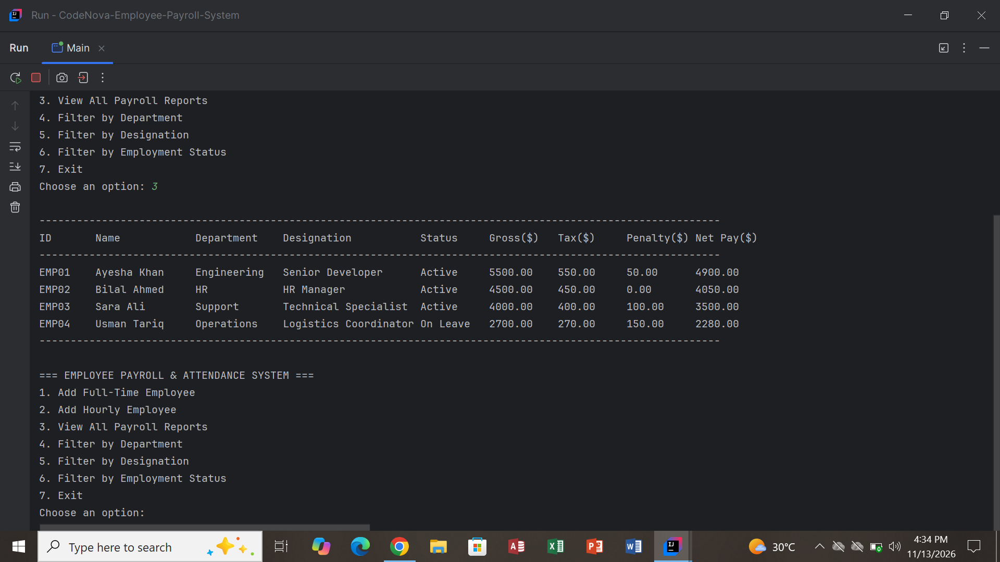
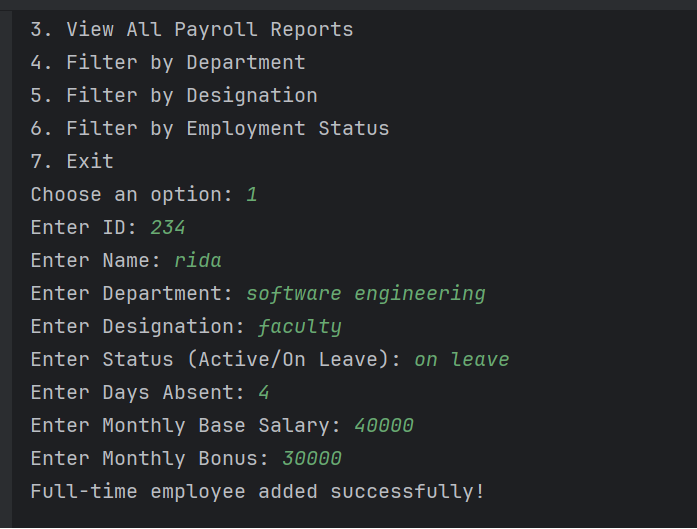

# CODE-NOVA-EMPLOYEE-PAYROLL-SYSTEM
# Employee Payroll & Attendance System
This is a Java console application built for **Task 1** of the CodeNova Java Internship. It helps manage employee records, track attendance deductions, and calculate monthly salaries.
# What This Project Does
- **Supports Two Types of Employees:** Uses a main `employee` class with two child classes (`FullTimeEmployee` and `HourlyEmployee`) to calculate pay differently based on job type (inheritance and polymorphism).
- **Accurate Salary Math:** Uses `BigDecimal` to calculate gross salary, a 10% tax deduction, a $50 penalty for each absent day, and final net pay.
- **Saves Data Automatically:** Stores all employee details in a CSV file (`employees.csv`) so data is saved even after closing the program.
- **Easy Filtering:** Lets you search and filter payroll reports by department, job title (designation), or status (`Active` / `On Leave`).
  # Folder Structure
- `src/model/` - Contains the employee classes (`employee`, `FullTimeEmployee`, `HourlyEmployee`).
- `src/service/` - Contains the payroll logic and search filters (`PayrollService`).
- `src/repository/` - Handles saving and loading records from `employees.csv` (`EmployeeRepository`).
- `src/ui/` - Contains the console menu and user input checks (`Main`).
- `employees.csv` - Sample employee data file.
- `screenshots/` - Screenshots of the program running.
  # How to Run It
1. Open the project in IntelliJ IDEA (with Java 11 or higher).
2. Open `src/ui/Main.java` and click **Run**.
3. Follow the menu numbers (`1` to `7`) in the console to add employees, view reports, or filter records.
# Screenshots

